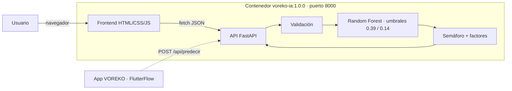

# VOREKO IA — Fase II (Ejecución)

**Solución desplegable del sistema de alertas de sobrecosto**

Maestría en Inteligencia Artificial · Universidad Tecmilenio · Gestión de Proyectos de Inteligencia Artificial
José Ignacio Castillo Camacho · AL07161745

El modelo elegido en la Actividad 6 (Random Forest que estima la probabilidad de que una obra termine con un sobrecosto mayor al 50 %) se empaqueta en un contenedor Docker con una API REST (FastAPI) y un frontend web que muestra el resultado como semáforo.

> Modelo candidato y de apoyo a la decisión. Se entrenó con el *Residential Building Data Set* (UCI 437, Teherán), así que los montos están en millones de riales. En las 75 obras de prueba: recall 0.538, precisión 0.560, AUC 0.803.

## Arquitectura



## Estructura

```
FaseII/
├── Dockerfile                    imagen multi-etapa (entrenamiento → servicio)
├── Dockerfile.dockerignore       archivos que entran al contexto de construcción
├── docker-compose.yml
├── requirements-api.txt
├── requirements-entrenamiento.txt
├── requirements-pruebas.txt
├── modelo/entrenar_modelo.py     reentrena el modelo de la A6 y lo verifica
├── api/
│   ├── main.py                   endpoints, validación de errores, frontend y documentación
│   ├── servicio_modelo.py        carga del modelo, reglas de datos, semáforo y factores
│   └── esquemas.py               esquemas de entrada y salida
├── frontend/                     index.html, estilos.css, app.js, vendor/ (Swagger UI y ReDoc)
├── tests/                        63 pruebas (funcionales, casos extremos, comportamiento)
└── validacion/
    ├── prueba_contenedor.py      prueba de humo contra el contenedor en ejecución
    ├── analisis_comportamiento.py
    └── resultados/               salidas reales de las pruebas y gráficas
```

En la raíz del repositorio están `render.yaml` (despliegue en Render) y `.github/workflows/faseii-contenedor.yml` (integración continua).

## Ejecución local con Docker

Requisitos: Docker Desktop 4.x o Docker Engine 24 o superior, y unos 2 GB libres. Todos los comandos se ejecutan **desde la raíz del repositorio**.

```bash
git clone https://github.com/Ignacio-Castillo-C/voreko-ia-incidencias.git
cd voreko-ia-incidencias

docker build -f FaseII/Dockerfile -t voreko-ia:1.0.0 .
docker run -d --name voreko-ia -p 8000:8000 voreko-ia:1.0.0
docker ps                                  # STATUS debe decir (healthy)
```

Otra opción es usar Docker Compose:

```bash
docker compose -f FaseII/docker-compose.yml up -d --build
docker compose -f FaseII/docker-compose.yml ps
```

| Dirección | Contenido |
|---|---|
| http://localhost:8000 | Frontend (semáforo, lote de prueba, información del modelo) |
| http://localhost:8000/docs | Documentación interactiva Swagger |
| http://localhost:8000/redoc | Documentación ReDoc |
| http://localhost:8000/api/salud | Estado del servicio |

Prueba de humo del contenedor (solo usa la biblioteca estándar de Python):

```bash
python FaseII/validacion/prueba_contenedor.py http://localhost:8000
```

Para detener y borrar el contenedor: `docker rm -f voreko-ia` (o `docker compose -f FaseII/docker-compose.yml down`).

### Variables de entorno

| Variable | Valor por defecto | Uso |
|---|---|---|
| `PORT` | `8000` | Puerto donde escucha el servicio (Render y Cloud Run lo asignan automáticamente) |
| `LIMITE_LOTE` | `500` | Máximo de obras por llamada a `/api/predecir/lote` |
| `VOREKO_CORS` | `*` | Orígenes permitidos, separados por comas (por ejemplo, el dominio de FlutterFlow) |
| `NIVEL_LOG` | `INFO` | Nivel de la bitácora |

## Ejecución sin Docker (desarrollo)

```bash
python -m venv .venv && source .venv/bin/activate      # Windows: .venv\Scripts\activate
pip install -r FaseII/requirements-entrenamiento.txt -r FaseII/requirements-pruebas.txt
python FaseII/modelo/entrenar_modelo.py               # crea FaseII/modelo/artefactos/
python -m pytest -q FaseII/tests                       # 63 pruebas
uvicorn main:app --app-dir FaseII/api --port 8000
```

## API

| Método | Ruta | Descripción |
|---|---|---|
| GET | `/api/salud` | Estado del servicio y versión del modelo (503 si el modelo no está cargado) |
| GET | `/api/modelo` | Umbrales, métricas de prueba, variables con sus rangos e importancia |
| GET | `/api/obras-ejemplo` | Las 75 obras de prueba (`?completo=true` incluye todas sus variables) |
| GET | `/api/obras-ejemplo/{id}` | Variables de una obra de prueba |
| POST | `/api/predecir` | Evalúa una obra: probabilidad, semáforo, factores, advertencias |
| POST | `/api/predecir/lote` | Evalúa hasta `LIMITE_LOTE` obras en una sola llamada |

Ejemplo de solicitud:

```json
{
  "id_proyecto": "RB-346",
  "variables": { "anio_inicio": 1386, "trimestre_inicio": 2, "localidad": 20, "area_construida_m2": 1070, "...": "28 variables" },
  "incluir_factores": true
}
```

Respuestas de error: `422` (datos inválidos, con la lista `errores` por variable), `413` (lote demasiado grande), `404` (obra inexistente) y `503` (modelo no cargado).

## Reproducibilidad

- El modelo se reentrena dentro de la imagen con la semilla 42 y la misma partición y rejilla de la A6. La construcción se detiene si las probabilidades, el umbral (0.39), el recall (0.538), la precisión (0.560) o el AUC (0.803) no coinciden con la A6.
- scikit-learn queda fijo en 1.9.1, la versión con la que se obtuvieron los resultados oficiales de la A6. Con 1.6.1 el umbral cambia a 0.38.
- `metadatos_modelo.json` guarda las huellas SHA-256 de los datos y del modelo.

## Despliegue en la nube

La estrategia principal es un contenedor en Render (PaaS) con `render.yaml`: *New → Blueprint →* seleccionar el repositorio. Las alternativas son Google Cloud Run y Azure Container Apps. El paso a paso completo está en el *Manual de despliegue en la nube* (entregable de la Fase II).
